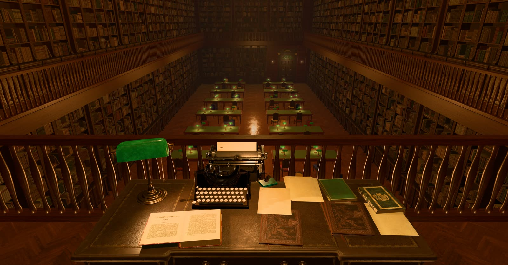
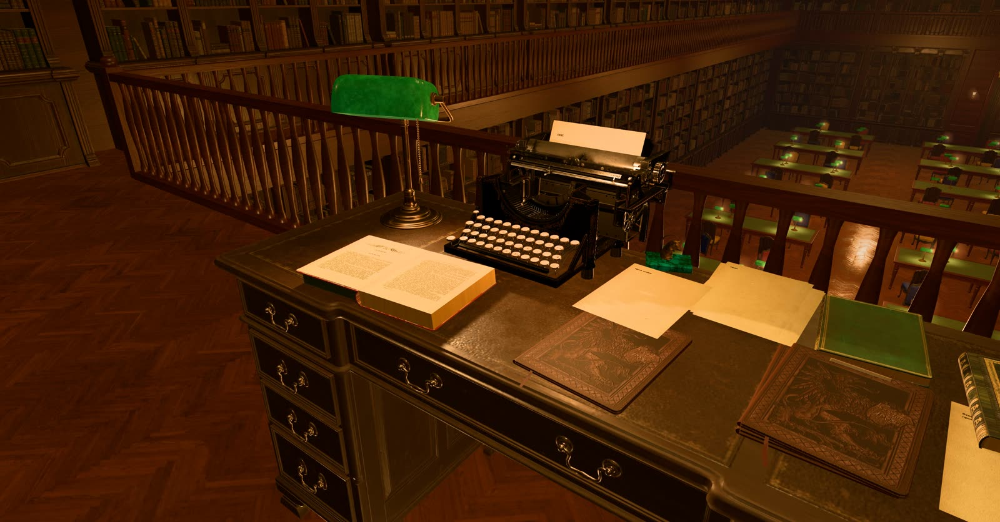
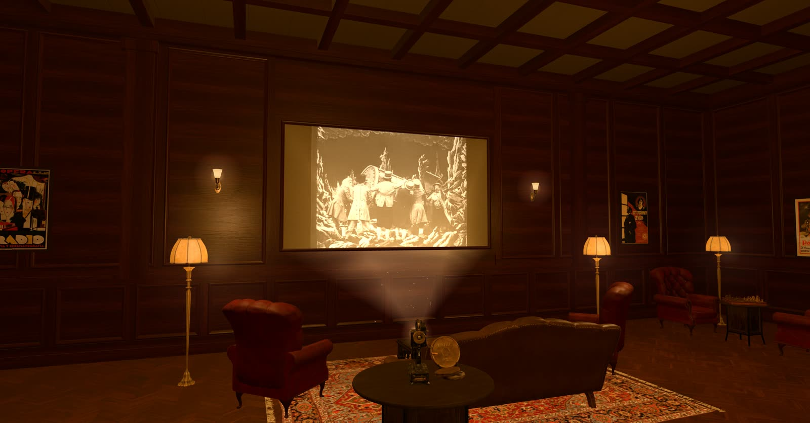

<div align="center">

# Exedra

**A quiet hall for reading, writing and watching old films — in your browser.**

A 3D reading room of the 1900s: a desk on the gallery, a green banker's lamp, a real typewriter,
your own books on a reading stand, and a film corner under the balcony with a 1920s projector.

[**chestnykh.net**](https://chestnykh.net/) · [Report a problem](https://github.com/CorazonCruzo/exedra/issues) · ⭐ [Star on GitHub](https://github.com/CorazonCruzo/exedra)



</div>

> In ancient gymnasia and villas, an *exedra* was a recess lined with benches, set a little apart from the bustle — a place to read, write and talk. Exedra is the same idea.

## What you can do

- **Type on a typewriter.** A real 3D model with recorded typewriter sounds; every key moves. Sheets come out onto the desk with the ink of a fabric ribbon.
- **Keep your pages in folders.** Leather folders with an embossed griffin — as many as you like. Leaf through them, label them, shuffle the sheets, put them away in the desk drawers, download a folder as a PDF.
- **Read your own books.** Drop a PDF into the window and it becomes a leather-bound book: turn pages by hand, riffle the fore-edge, add silk ribbon bookmarks, put it on a wooden reading stand, or switch to a quiet full-screen reading mode.
- **Watch films on the wall.** A Pathé-Baby projector throws its beam across the film corner:
  - a **silent film library** — a hand-picked selection and the whole Wikimedia Commons archive of silent films, with filters and search;
  - **video from your computer** — including old AVI/DivX, DVD (VOB), and films whose audio browsers can't play (AC-3, DTS, TrueHD) — decoded right in the page;
  - **links** from YouTube, Rutube, VK Video, Vimeo, or a direct link to a video file;
  - subtitles from the film or from your own `.srt`, `.vtt`, `.ass`.
- **Live in the room.** The sun moves with your clock and lights the windows; turn the wall clock to change the time of day. Move the lamp, spin the globes, pull the lamp chains, choose the dome paintings and the paperweight.
- **Keep everything.** The desk is saved in your browser; save it to a single file and open it on another computer.

<p align="center">
  
  
</p>

A short interactive tour teaches the basics the first time you come in — and can be taken again any time from the help (?) or the room decor.

**Languages:** English, Español, Deutsch, Français, Português, 日本語, 中文, Ελληνικά, Русский — picked from your browser, changeable in the room decor.

**Devices:** a computer or a tablet. On phones the room is too small to use.

## Run it locally

No build step — plain ES modules and three.js.

```sh
git clone https://github.com/CorazonCruzo/exedra.git
cd exedra
python3 tools/serve.py
```

Then open <http://localhost:5210/>. (`tools/serve.py` tells the browser not to cache modules; any static server works, but may serve a stale module.)

Your data stays in your browser (`localStorage` and the Origin Private File System for PDFs). Nothing is uploaded anywhere; films and links are fetched straight from their sites.

## How it's made

- **Rendering:** [three.js](https://threejs.org/) r170 — one draw path, everything compiled behind the loading screen, aiming for 60 fps.
- **Books:** [MuPDF](https://mupdf.com/) in WebAssembly (with [pdf.js](https://mozilla.github.io/pdf.js/) as a fallback), pages streamed from the file without loading it whole.
- **Films:** [FFmpeg](https://ffmpeg.org/) via [libav.js](https://github.com/Yahweasel/libav.js) in WebAssembly, in a worker: audio decoding and old video codecs, synced to the picture.
- **Everything real:** models, textures, sounds, posters and paintings are real scans, recordings and public-domain works — see [CREDITS.en.md](CREDITS.en.md).

## License

© 2026 Anastasiia Chestnykh.

- **Code** (`index.html`, `src/`, `tools/`) — [GNU AGPL-3.0-or-later](LICENSE): you may use, change and share it, but anything built on it must stay open under the same license.
- **The author's own texts and design** — [CC BY-SA 4.0](https://creativecommons.org/licenses/by-sa/4.0/).
- **Third-party models, photos, textures, sounds and films** keep their own licenses (CC0, CC BY, CC BY-SA, public domain) — attribution in [CREDITS.en.md](CREDITS.en.md) ([на русском](CREDITS.md)).
- **Libraries in `vendor/`** — under their own licenses: three.js (MIT), pdf.js (Apache-2.0), MuPDF (AGPL-3.0-or-later, Artifex), FFmpeg via libav.js (LGPL-2.1-or-later). Fonts — SIL Open Font License.

## Contact

Made by **Anastasiia Chestnykh** — [chestnykh.net](https://chestnykh.net/) · [exedra@chestnykh.net](mailto:exedra@chestnykh.net) · [GitHub](https://github.com/CorazonCruzo).
If you like Exedra, a ⭐ on GitHub means a lot.
